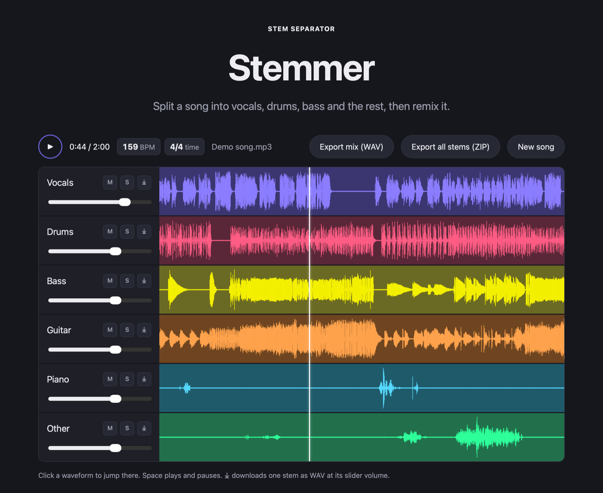

# Stemmer

**Split any song into its parts and remix it, entirely on your own computer.**



## What is Stemmer?

Stemmer is a desktop app for Mac and Windows that takes a song (or a music video) and separates it into individual instrument tracks, called *stems*: vocals, drums, bass, the rest, and optionally guitar and piano. You can then rebalance them in a mixer, solo or mute any part, and export the result.

It's useful for practising along with a song without the part you play, making karaoke or backing tracks, transcribing a bass line, or remixing.

Everything runs locally. Your songs never leave your computer, there's no account, no upload limit and no subscription, and it works offline.

## Features and what makes it different

| | |
|---|---|
| 🎚️ **4 or 6 stems** | Vocals, drums, bass and other, or add guitar and piano. Powered by Meta's Hybrid Transformer Demucs, a state-of-the-art separation model. |
| 🎛️ **Built-in mixer** | Volume, mute and solo for every stem, waveforms, click-to-seek, Space to play or pause. All stems stay sample-locked in sync. |
| 🥁 **Tempo and time signature** | Shows the BPM and meter (4/4 or 3/4), detected from the separated drums for accuracy. |
| 🎬 **Audio or video in** | MP3, WAV, FLAC, M4A, OGG, plus MP4, MOV, MKV and WEBM. The audio is extracted automatically. |
| 💾 **WAV export, three ways** | One stem, all stems as a ZIP, or your current mix as one file. |
| 🔒 **Private and offline** | The AI runs on your computer (Apple Silicon GPU on Mac, CPU on Windows). Nothing is uploaded anywhere. |
| 💸 **Free, no limits** | No account, no credits, no file-size paywall. Open source. |

**Why Stemmer instead of an online splitter?** Web services upload your files to their servers, cap file sizes or song counts, and often charge for more stems or WAV downloads. Stemmer gives you the same class of AI model with none of that, plus tempo and meter detection and a full mixer, in a native app.

## Download

**[⬇ Download the latest release](https://github.com/alfathony/stemmer/releases/latest)**

| Your computer | File |
|---|---|
| Mac with Apple Silicon | `Stemmer-<version>-mac-arm64.dmg` |
| Windows 10/11 (64-bit) | `Stemmer-<version>-windows-x64-setup.exe` |

**Mac**
1. Open the `.dmg` and drag **Stemmer** into **Applications**.
2. Open Stemmer. The first time, macOS blocks it because the app isn't signed by a registered Apple developer yet:
   - Click **Done** on the warning.
   - Go to **System Settings → Privacy & Security**, scroll down and click **Open Anyway** next to Stemmer.
   - Confirm with **Open**. macOS remembers this, so you only do it once.

**Windows**
1. Run the setup `.exe`. If SmartScreen says "Windows protected your PC", click **More info → Run anyway**. The installer isn't code-signed yet.
2. It installs for your user account, with no admin rights needed, and adds Stemmer to the Start menu.

Then drop a song in. The first separation also loads the model.

## System requirements

**To run the app**

| | Mac | Windows |
|---|---|---|
| Processor | Apple Silicon (M1 or newer) | 64-bit Intel or AMD, 4+ cores recommended |
| System | macOS 12 Monterey or newer (tested on macOS 26) | Windows 10 (1809) or 11 |
| Memory | 8 GB, 16 GB recommended | 8 GB, 16 GB recommended |
| Disk | 2 GB free | 3 GB free |
| AI runs on | Apple GPU (falls back to CPU) | CPU |
| 5-minute song | ~2–3 min on an M3 | several minutes, depending on the CPU |

Intel Macs aren't supported yet. Windows uses the built-in Microsoft Edge WebView2, which Windows 10/11 already include.

**To build from source**: macOS on Apple Silicon, Python 3.11 ([uv](https://github.com/astral-sh/uv) recommended), Node.js 18+, and ffmpeg for the web version.

```bash
# backend
cd backend && uv venv --python 3.11 .venv
uv pip install --python .venv/bin/python -r requirements.txt -r ../desktop/requirements.txt

# frontend
cd ../frontend && npm install

# a) run as a web app: http://localhost:5173 (needs `brew install ffmpeg`)
(cd ../backend && .venv/bin/uvicorn app:app --port 8000) & npm run dev

# b) or build the Mac app: desktop/dist/Stemmer.app and the .dmg
cd .. && ./desktop/build_mac.sh
```

On Windows, create the venv with `backend\.venv\Scripts\python.exe`, install [Inno Setup 6](https://jrsoftware.org/isinfo.php), then run `desktop\build_windows.ps1`. It produces the setup `.exe`.

### Releasing a new version

GitHub Actions ([`.github/workflows/build.yml`](.github/workflows/build.yml)) builds both installers on GitHub's Mac and Windows machines, runs a self-test on each packaged app, and publishes a release:

```bash
git tag v0.2.0 && git push origin v0.2.0   # → release "Stemmer 0.2.0" with the .dmg, the .exe and SHA256SUMS.txt
```

To build without releasing, use **Actions → Build installers → Run workflow**; the installers appear under the run's *Artifacts*. You can also check any packaged app yourself with `Stemmer --selftest report.json`, which separates a generated 128 BPM drum loop and checks the stems, the tempo and the meter.

<details>
<summary>Project layout and API</summary>

```
backend/    FastAPI server: upload → Demucs separation → tempo/meter analysis → stems
frontend/   Vite + TypeScript UI: upload, Web Audio mixer, waveforms, WAV/ZIP export
desktop/    Desktop app: native window launcher, PyInstaller spec, icons, Mac/Windows build scripts, Inno Setup installer
```

| Method | Path | |
|---|---|---|
| POST | `/api/jobs` | multipart `file` and `mode` (`4stems` or `6stems`) → job |
| GET | `/api/jobs/{id}` | `status` (`queued`, `extracting`, `processing`, `encoding`, `analyzing`, `done`, `error`), `progress`, `stems`, `analysis` (`bpm`, `time_signature`) |
| GET | `/api/jobs/{id}/stems/{stem}.mp3` | download one stem |

The desktop app stores working files and `stemmer.log` in `~/Library/Application Support/Stemmer/` (Mac) or `%APPDATA%\Stemmer` (Windows). Set `STEMMER_DEVICE=cpu|mps|cuda` to force where the AI runs.

</details>

## Libraries used

| Library | Used for | License |
|---|---|---|
| [Demucs](https://github.com/facebookresearch/demucs) 4.0.1 (`htdemucs`, `htdemucs_6s`) | AI stem separation | MIT |
| [PyTorch](https://pytorch.org) 2.5 + torchaudio | Running the model on the Apple GPU (MPS) or CPU | BSD-3-Clause |
| [librosa](https://librosa.org) 0.10 | Beat tracking, tempo and time signature | ISC |
| [NumPy](https://numpy.org) / [SciPy](https://scipy.org) / [Numba](https://numba.pydata.org) | Signal processing (via librosa) | BSD |
| [FastAPI](https://fastapi.tiangolo.com) + [Uvicorn](https://www.uvicorn.org) | Local API server | MIT / BSD-3-Clause |
| [FFmpeg](https://ffmpeg.org) via [imageio-ffmpeg](https://github.com/imageio/imageio-ffmpeg) | Reading audio and video files | GPL (binary) / BSD-2-Clause |
| [lameenc](https://github.com/chrisstaite/lameenc) | MP3 encoding of stems | LGPL-3.0 |
| [soundfile](https://github.com/bastibe/python-soundfile) | Audio file I/O | BSD-3-Clause |
| [pywebview](https://pywebview.flowrl.com) | Native window (WebKit on Mac, Edge WebView2 on Windows) | BSD-3-Clause |
| [PyInstaller](https://pyinstaller.org) | Packaging the desktop app | GPL-2.0 with bootloader exception |
| [Inno Setup](https://jrsoftware.org/isinfo.php) | Windows installer | Inno Setup License (free) |
| [Vite](https://vitejs.dev) + [TypeScript](https://www.typescriptlang.org) | Frontend build | MIT / Apache-2.0 |
| Web Audio API | Mixer, playback and offline WAV rendering (built into the browser engine) | n/a |

See [THIRD_PARTY_NOTICES.md](THIRD_PARTY_NOTICES.md) for redistribution details.

## Inspired by

- **[vocalremover.org Splitter AI](https://vocalremover.org/splitter-ai)**: the original idea. Upload a song, get stems, mix them in the browser. Stemmer reworks that flow as a free, offline, open-source desktop app.
- **[Demucs](https://github.com/facebookresearch/demucs)** by Alexandre Défossez and Meta AI Research, whose open models make high-quality separation possible on a laptop.

## License

Stemmer's own code is [MIT licensed](LICENSE). Bundled third-party components keep their own licenses; see [THIRD_PARTY_NOTICES.md](THIRD_PARTY_NOTICES.md).

Please only separate music you have the right to use. Stems from copyrighted songs are for personal practice and study.
