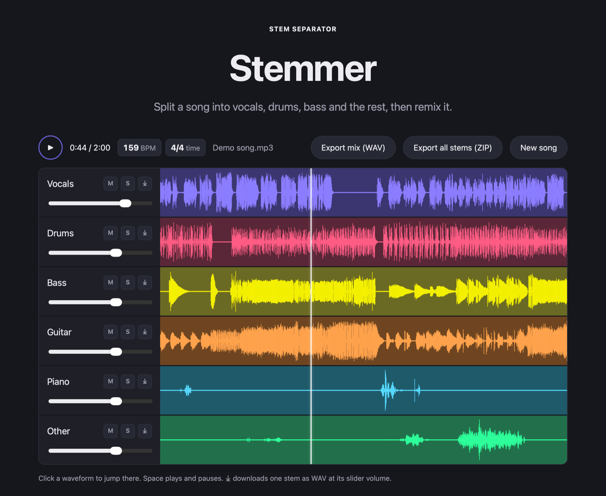

**Stemmer {VERSION}**: split any song or music video into vocals, drums, bass, guitar, piano and the rest, remix them, see the tempo and time signature, and export WAV. It runs entirely on your computer.

## Download

| Your computer | File |
|---|---|
| Mac with Apple Silicon (M1 or newer), macOS 12+ | `Stemmer-{VERSION}-mac-arm64.dmg` |
| Windows 10 (1809+) or 11, 64-bit | `Stemmer-{VERSION}-windows-x64-setup.exe` |

### Mac
1. Open the `.dmg` and drag **Stemmer** into **Applications**.
2. The first time, macOS blocks the app because it isn't signed by a registered Apple developer yet. Go to **System Settings → Privacy & Security**, click **Open Anyway** next to Stemmer, then **Open**. You only need to do this once.

### Windows
1. Run the setup `.exe`. If Windows SmartScreen says "Windows protected your PC", click **More info → Run anyway**. The installer isn't code-signed yet.
2. Stemmer installs for your user account, with no admin rights needed, and adds a Start menu entry.
3. On Windows the AI runs on the CPU, so expect a few minutes per song.

`SHA256SUMS.txt` lists checksums for both files.
